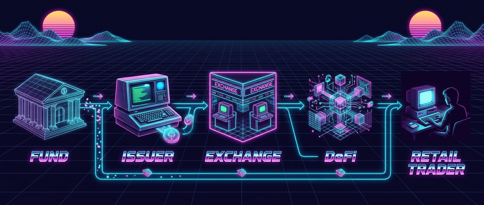
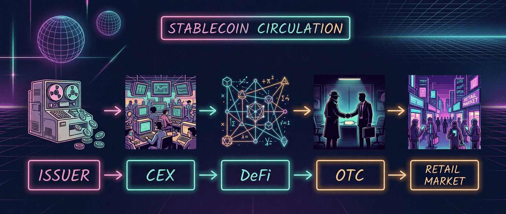

## Introduction

Stablecoin transaction volume exceeded $25 trillion last year. This is not a speculative bubble -- it is an infrastructure shift. Institutional investors, market makers, and funds use USDT and USDC not for speculation on volatility, but as a settlement unit in day-to-day operations.

Stablecoins have stopped being "digital dollars for traders." They have become the circulatory system of the crypto market -- the channel through which capital flows between exchanges, DeFi protocols, and funds. Understanding this mechanics is important for any market participant.

## Institutional demand: what changed

Three years ago, institutional presence in crypto was measured by products like Bitcoin ETFs. Today, the conversation is about structural demand for infrastructure that operates 24/7 without intermediaries.

**The role of funds and asset managers.** Large asset management firms (Grayscale, BlackRock, Fidelity) attract capital not because crypto is "fast money." They see digital assets as portfolio diversification with low correlation to traditional asset classes. But the key insight is that capital inflows remain stable even during BTC drawdowns. This signals mature demand, not speculative frenzy.

**Inter-exchange settlements.** Previously, moving funds between exchanges took days through banking systems. Today, market makers and funds move millions via USDT and USDC in minutes. The fee is fractions of a cent, the time is seconds. This changes the economics of liquidity: capital does not "get stuck" on one platform, but circulates through the market.

**DeFi liquidity.** Institutional capital is not just held in stablecoins -- it generates yield through lending and DEX protocols. Aave, Compound, and Uniswap process transactions at scales comparable to traditional money market funds.

## Stablecoins as infrastructure

Stablecoins are not simply "tokenized dollars." They are an infrastructure layer that replaces traditional banking correspondent accounts and clearing systems.

**Transaction volume vs market size.** The stablecoin market is valued at approximately $260 billion (USDT ~$140B, USDC ~$70B). But annual transaction volume is $25+ trillion. A 100x difference shows that one dollar circulates multiple times. This is a classic sign of payment infrastructure: money does not "buy" something once, but is used as a means of settlement.

**Role in inter-exchange settlements.** When a fund opens a position on Binance and closes it on Bybit, the price difference must be settled. Previously, this was done through bank transfers -- 1-3 days. Today, the fund transfers USDT to the exchange wallet -- 30 seconds. This allows arbitrageurs and market makers to operate with tighter spreads, improving price quality for all participants.

**Liquidity in DeFi.** USDC and USDT are the foundation of liquidity in decentralized protocols. Stablecoin pools on DEXes provide deep liquidity without margin calls or credit checks. Institutional players use this for hedging, arbitrage, and yield generation on surplus capital.

**Reserves and issuers.** USDT is issued by Tether, USDC by Circle. Both claim 100% reserve in dollar-denominated assets. Tether publishes quarterly audits, Circle publishes monthly attestations. The difference in transparency: Circle has passed SOC 1 and SOC 2 certification, Tether has not. For institutional clients, this is an important due diligence factor.

## Risks and regulation

Infrastructure that operates without intermediaries attracts regulatory attention. Stablecoins are no exception.

**Issuer reserves.** The key risk of stablecoins is the issuer's inability to ensure redemption at parity. The TerraUSD (UST) incident in 2022 showed that algorithmic stablecoins are not stablecoins, but volatile assets with a different name. After that, regulators tightened requirements: issuers must hold reserves in cash and short-term government bonds, not in corporate bonds.

**KYC/AML requirements.** The Financial Crimes Enforcement Network (FinCEN) in the US and FATF internationally require stablecoin issuers to comply with KYC/AML. This means issuers can freeze addresses and block transactions. For users, this means stablecoins are not fully censorship-resistant assets.

**MiCA and global regulation.** The Markets in Crypto-Assets (MiCA) regulation, effective in the EU since 2024, establishes uniform rules for stablecoin issuers. Requirements include: minimum capital of EUR 5 million, reserves in the form of deposits and government bonds, monthly reports. Issuers failing to meet requirements must cease operations in the EU by 2025.

**SEC and stablecoin status.** The U.S. Securities and Exchange Commission has not yet determined the status of stablecoins. USDC challenged a freeze on an address linked to a hack in court -- and won. This is a precedent defining the boundaries of stablecoin censorship.

## What this means for traders

Understanding institutional flows through stablecoins provides practical advantages.

**Liquidity and spreads.** When USDT issuance volume grows -- this is new capital inflow. When USDC dominates circulation -- this signals institutional presence. Tracking these metrics helps assess overall market sentiment.

**Inter-exchange arbitrage.** Fast stablecoin transfers between exchanges create arbitrage opportunities. The price difference for BTC on Binance and Bybit can reach 0.5% -- and stablecoins make this arbitrage accessible not only to market makers, but to retail traders with sufficient capital.

**Stablecoin flow as an indicator.** Growth in total stablecoin market cap often precedes BTC growth. New capital enters stablecoins on exchanges and then converts to Bitcoin and altcoins. This is not a growth guarantee, but the correlation is supported by statistics.

**Counterparty risk.** Holding funds on a single exchange or in one DeFi protocol creates concentration risk. Diversification across multiple platforms and using cold storage for long-term positions is a basic practice that institutional players have applied for decades.

## Summary

Stablecoins have evolved from a tool for crypto traders into a payment infrastructure that services institutional capital flows. Annual transaction volume of $25+ trillion is not speculation, but a functional market need for fast, cheap, and 24/7 accessible settlements.

For regulators, stablecoins are a challenge: they operate without bank intermediaries, but fall under KYC/AML requirements. For traders, they present an opportunity: understanding stablecoin flows provides insights into market liquidity and sentiment.

Investments in digital assets involve risks. Stablecoins are no exception: issuer risk, regulatory risk, and technological vulnerabilities require a conscious approach.

## FAQ

**How does USDT differ from USDC in terms of safety?**

USDT is issued by Tether with quarterly audits but no SOC certification. USDC is issued by Circle with monthly attestations and SOC 1/SOC 2 certification. For institutional clients, USDC is preferable due to higher transparency. For retail traders, the difference is minimal when using both issuers.

**Can stablecoins be used for international transfers?**

Yes. Transferring USDT or USDC between wallets takes minutes and costs fractions of a cent. This makes stablecoins an alternative to banking SWIFT transfers for international settlements. However, regulatory risks (address freezes) limit their use for large amounts.

**How to track stablecoin flows in real time?**

Stablecoin issuance and circulation metrics are published on CoinGecko, CoinMarketCap, and issuer reports (tether.to, circle.com). For detailed analysis, Dune Analytics and DeFi Llama can be used to track TVL volumes in stablecoin protocols.

**What happens if a stablecoin issuer goes bankrupt?**

In the event of an issuer default, stablecoin holders become creditors and claim reserve assets. Historically, Tether and Circle have had no incidents of inability to redeem. However, counterparty risk is always present -- diversification across multiple stablecoins and issuers reduces this risk.
