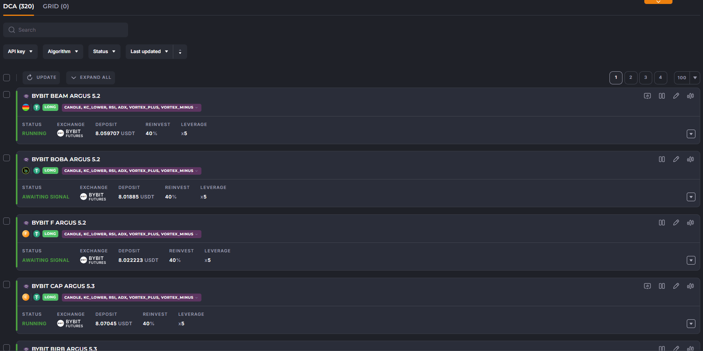
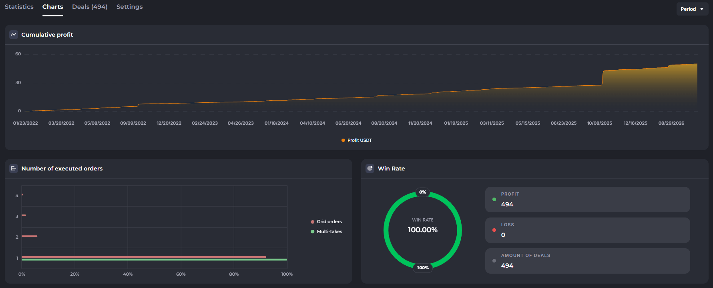

## Why Automation Exists at All

Humanity has always sought ways to stop doing by hand what can be offloaded to something else. The wheel. Water mills. Steam engines. Assembly lines. The same motive repeats every time: free attention and energy for what truly matters.

In trading, this motive is especially acute. The cryptocurrency market never sleeps. Humans do. Or get sick. Or simply cannot sit at a screen for sixteen hours straight.

The shift toward algorithmic trading often begins with the realization of physical and temporal limitations. Manual position monitoring around the clock ceases to be realistic. What remains is knowledge, the desire to keep working with the market, and the need to find a way to do it without constant presence at a terminal.

Sometimes this shift is driven not by interest in technology, but by constraints. Physical, temporal, financial. When physical limitations prevent sitting at a terminal, when timeframes prevent monitoring positions overnight, when the only available resources are a laptop, knowledge, and the desire to build a system. Under such circumstances, bots are not a luxury or a hobby, but the only way to keep working with the market.

In that situation, the natural next step is to formalize logic and hand execution over to systems.

This transition is explored in detail in [«Why Algorithms: From Manual Trading to Systematic Trading»](/en/saga/algo-journey/) — where the first mistakes, the mechanics of backtesting, and the architecture of a system that grew from intuitive decisions are shown.

## Small Helpers

The essence of proper trading automation is simple: while attention is occupied with market analysis or other tasks, trading bots perform repetitive actions according to formalized rules. This is not a "robot that prints money." It is a set of small helpers that handle routine work and free up time for what cannot be delegated.

How this looks in practice:

- **A DCA bot** builds a position with a grid of averaging orders. If the price moves against the position, the bot lowers the average entry price. If the price reverses, it closes the entire trade with a single order at a fixed profit percentage. One cycle can take hours or days, but human attention is not required during the process.
- **A GRID bot** operates in sideways markets. Within a predefined price range, the bot places pairs of orders: buys at the lower boundary, sells at the upper. The more volatility within the range, the more closed pairs. On a trending market, such a bot is inefficient — this is a limitation, not a flaw.
- **Bots in long and short** can run in parallel on the same asset. On futures — through position hedging, on spot — through separate deposits. This allows the system to respond to both market directions.
- **Signal logic** is configured through technical analysis indicators (RSI, MACD, SMA), price filters, or webhook alerts from TradingView. The output is a fixed profit percentage, an indicator signal, or a price level.

Each helper covers a specific market condition: trend, sideways, volatility, nighttime hours when a person physically cannot watch the terminal. A combination of several bots with different settings and directions forms a system that runs 24/7 without operator presence.

That is the point of the metaphor: small helpers work constantly. Their results do not guarantee profit, but they ensure what is impossible without them — continuous execution of logic designed by a human.

Their output is not "financial freedom," but coverage of operational expenses. Tool subscriptions, data access, infrastructure, hosting, API fees. Small things that stop hanging on main income. One bot closed a trade in profit — that covered the subscription. Another brought a bit more — there was a budget for next month. This is not a wealth strategy, but basic hygiene for independent work.

## The Veles Platform as a Tool

Veles is a platform where logic is formalized, tested on historical data, and launched without a dedicated server or constant presence at a terminal. It works with both spot and futures.

**How the workflow is structured.** A logical sequence looks like this:

1. **Strategy selection.** The dashboard has a showcase of ready-made bots from the team and community. They can be copied, parameters studied, and adapted to your needs — without having to invent everything from scratch.
2. **Testing.** Backtesting on historical data shows potential profitability, maximum drawdown, and the number of trades over the selected period. This is not a guarantee of results, but a way to see how a strategy would have behaved in different market regimes.

3. **Preparation.** API keys and restrictions are configured before launch — trading rights without withdrawal rights. Funds remain on the exchange; the platform does not hold them.
4. **Launch.** The bot connects to the exchange via API, places and cancels orders, and manages trades. On the exchange side, its activity is visible only through order execution and results.
5. **Monitoring.** Bot statistics, active trades, result notifications — all of this is available in the dashboard or mobile app.

**What is supported.** Connection to major cryptocurrency exchanges via API or through Veles Broker. Three trading modes: single order, dollar-cost averaging grid (DCA), simple grid bot (GRID). Signals — TA indicators, price filters, TradingView webhooks.

**How pricing works.** A service commission of 20% of profit, but no more than 50 USDT per month per trading type. Payment occurs only when there is a result: if the bot does not generate profit, no commission is charged. The platform architecture is built on a non-custodial storage principle: funds remain on the exchange, and API keys are configured with withdrawal disabled.

User funds always stay on the exchange. Veles does not act as a custodian and has no withdrawal rights.

## Community and Working Principles

The most valuable aspect of such an environment is not specific bot settings. It is people.

A bot card can be copied in five minutes. But why those exact parameters, under which market conditions they work, what happens on a level breakout, how to interpret a drawdown, and when to stop a strategy — all of this emerges only through discussion with those who have already been through it.

There is plenty of material on algorithmic trading in English, but it is either academic or marketing-driven. The gap between "read about it" and "actually launched it" is bridged by community: an active Telegram chat where configurations and mistakes are discussed, an Academy for getting started from zero, documentation describing every setting, and free consultations with the team.

Separately worth noting is how interaction is structured within such a community. Principles that have proven effective over the long term:

- **Do not hoard knowledge.** Sharing your logic and mistakes does not reduce your edge — it preserves it: an environment that grows grows every participant.
- **Respect each other and help.** Beginner questions are not noise, but an entry point for those who once asked the same questions.
- **Take trading seriously.** This is not a lottery or a way to get rich quick. It is work with probabilities, risks, and discipline.
- **Build processes with integrity.** Not "extract at any cost," but construct a system that survives multiple market cycles.

That is why a collective path proves more resilient than a solitary one. A lone trader repeats others' mistakes and reinvents the wheel. In a community, mistakes have already been analyzed, and the wheel is in the documentation.

## What to Understand Upfront

Automation does not remove responsibility. A bot executes exactly the logic encoded into it. If the logic is poor, it will carefully and disciplinearily accumulate losses.

Therefore, the usual sequence is:

1. Backtest.
2. Small deposit.
3. Observation and adjustment.
4. Only then — scaling.

Markets change. Strategies that worked six months ago may stop working. Control is still needed — it just becomes targeted rather than round-the-clock.

## Risks and Legal Considerations

Investments in cryptocurrencies carry the risk of partial or total capital loss. Cryptocurrencies are not legal tender in the United States and many other jurisdictions. Backtest results and historical returns do not guarantee future profit — any trading, manual or automated, involves the risk of losses.

## Summary

Automation in trading is not a replacement for thinking, but a redistribution of time and attention. Routine work should be handed to systems. Analysis, architecture, and decision-making should remain with the human.

Veles is one tool within such a system. Not the only one, not magical. But convenient, transparent in its pricing model, and flexible enough to build a custom architecture around it.

While bots work, space opens up for what cannot be automated.

## FAQ

### Is programming knowledge required to use Veles?

Basic configurations are available without deep programming knowledge. The platform provides a modular structure where the initial level is configured through the interface. As experience grows, there is an opportunity to dive deeper into customization.

### Does Veles guarantee trading income?

Any trading involves the risk of partial or total capital loss. The platform helps prepare for launch: you can choose a strategy curated by experts or test your own on historical data using backtesting. This helps adjust settings and reduce risks, but does not eliminate the possibility of losses.

### How to test a strategy before launching?

Before launching on a live account, a strategy can be tested on historical data using backtesting. It will show how the strategy could have performed under different market conditions: potential profitability, maximum drawdown, number of trades, and other metrics. Test results do not guarantee future profit.

### Where to find support and community?

The Veles community is actively developing on their Telegram channel. They publish analyses, configuration discussions, and experience sharing. The platform also provides an Academy, a knowledge base, and the ability to get consultations through Calendly.

Veles can be explored and tested by registering through the link in the footer at the bottom of this page. Additional information about Felag is available on the [«About»](/en/about/) page.
