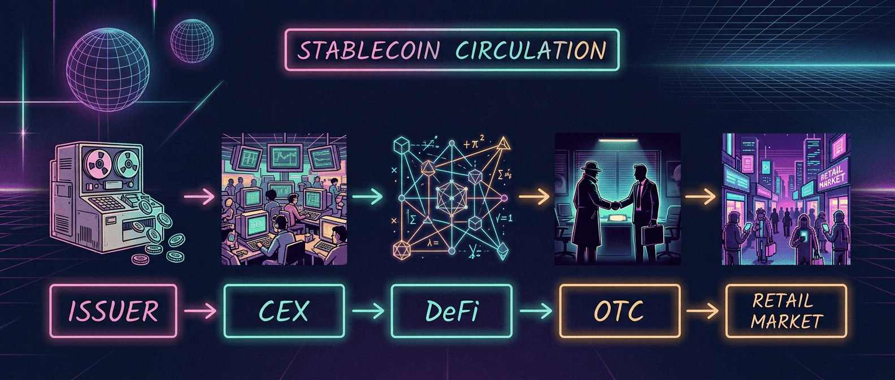

## Введение

Объём оборота стейблкоинов превысил $25 триллионов за последний год. Это не спекулятивный пузырь — это инфраструктурный сдвиг. Институциональные инвесторы, маркет-мейкеры и фонды используют USDT и USDC не для заработка на волатильности, а как расчётную единицу в повседневных операциях.

Стейблкоины перестали быть «цифровым долларом для трейдеров». Они стали кровеносной системой рынка цифровых активов — каналом, по которому капитал перетекает между биржами, протоколами DeFi и фондами. Понимание этой механики важно для любого участника рынка.

## Институциональный спрос: что изменилось

Три года назад институциональное присутствие на рынке цифровых активов измерялось продуктами вроде Bitcoin ETF. Сегодня речь идёт о структурном спросе на инфраструктуру, которая работает 24/7 без посредников.

**Роль фондов и управляющих компаний.** Крупные управляющие фонды (Grayscale, BlackRock, Fidelity) привлекают капитал не потому, что цифровые активы — это «быстрые деньги». Они видят в цифровых активах диверсификацию портфеля с низкой корреляцией к традиционным классам. Но ключевой инсайт — приток капитала остаётся стабильным даже во время просадок BTC. Это признак зрелого спроса, а не спекулятивного ажиотажа.

**Межбиржевые расчёты.** Раньше перевод средств между биржами занимал дни через банковские системы. Сейчас маркет-мейкеры и фонды перемещают миллионы через USDT и USDC за минуты. Комиссия — доли цента, время — секунды. Это меняет экономику ликвидности: капитал не «застревает» на одной площадке, а циркулирует по рынку.

**Ликвидность DeFi.** Институциональный капитал не просто хранится в стейблкоинах — он генерирует доход через протоколы lending и DEX. Aave, Compound, Uniswap обрабатывают транзакции на суммы, сопоставимые с объёмами традиционных money market фондов.

## Стейблкоины как инфраструктура

Стейблкоины — это не просто «токенизированные доллары». Это слой инфраструктуры, который заменяет традиционные банковские корсчета и клиринговые системы.

**Объём оборота vs объём рынка.** Рынок стейблкоинов оценивается примерно в $260 миллиардов (USDT ~$140 млрд, USDC ~$70 млрд). Но годовой объём транзакций — $25+ триллионов. Разница в 100 раз показывает, что один доллар циркулирует многократно. Это классический признак платёжной инфраструктуры: деньги не «покупают» что-то разово, а используются как средство расчёта.

**Роль в межбиржевых расчётах.** Когда фонд открывает позицию на Binance и закрывает её на Bybit, разница в цене должна быть компенсирована. Раньше это делалось через банковский перевод — 1-3 дня. Сейчас фонд переводит USDT на кошелёк биржи — 30 секунд. Это позволяет арбитражерам и маркет-мейкерам работать с tighter spreads, что повышает качество цены для всех участников.

**Ликвидность в DeFi.** USDC и USDT — основа ликвидности в децентрализованных протоколах. Пулы стейблкоин-пар на DEX обеспечивают глубокую ликвидность без маржин-колла и кредитных проверок. Институциональные игроки используют это для хеджирования, арбитража и генерации доходности на излишках капитала.

**Резервы и эмитенты.** USDT эмитируется Tether, USDC — Circle. Оба заявляют о 100%-ном резерве в долларовых активах. Tether публикует quarterly audits, Circle — monthly attestations. Разница в прозрачности: Circle прошёл SOC 1 и SOC 2 сертификацию, Tether — нет. Для институциональных клиентов это важный фактор due diligence.

## Риски и регуляция

Инфраструктура, которая работает без посредников, привлекает внимание регуляторов. Стейблкоины — не исключение.

**Резервы эмитентов.** Ключевой риск стейблкоинов — неспособность эмитента обеспечить redemption по паритету. Инцидент TerraUSD (UST) в 2022 году показал, что алгоритмические стейблкоины — это не стейблкоины, а волатильные активы с другим названием. После этого регуляторы ужесточили требования: эмитенты обязаны хранить резервы в кэше и краткосрочных гособлигациях, а не в корпоративных бондах.

**KYC/AML требования.** Финансовая целевая группа (FinCEN) в США и FATF на международном уровне требуют от эмитентов стейблкоинов соблюдения KYC/AML. Это означает, что эмитенты могут замораживать адреса и блокировать транзакции. Для пользователей это означает, что стейблкоины — не полностью цензуроустойчивый актив.

**MiCA и глобальная регуляция.** Regulation Markets in Crypto-Assets (MiCA), вступивший в силу в ЕС в 2024 году, устанавливает единые правила для эмитентов стейблкоинов. Требования включают: минимальный капитал €5 млн, резервы в виде депозитов и гособлигаций, ежемесячные отчёты. Эмитенты, не соответствующие требованиям, должны прекратить деятельность в ЕС к 2025 году.

**SEC и статус стейблкоинов.** Комиссия по ценным бумагам и биржам США до сих пор не определила статус стейблкоинов. USDC оспорил заморозку средств на адресе, связанном с взломом, в суде — и выиграл. Это прецедент, который определяет границы цензуры стейблкоинов.

## Что это значит для трейдера

Понимание институциональных потоков через стейблкоины даёт практические преимущества.

**Ликвидность и spreads.** Когда объём эмиссии USDT растёт — это приток нового капитала. Когда USDC доминирует в обороте — это признак институционального присутствия. Отслеживание этих метрик помогает оценивать общее настроение рынка.

**Межбиржевой арбитраж.** Быстрые переводы стейблкоинов между биржами создают возможности для арбитража. Разница в цене BTC на Binance и Bybit может достигать 0.5% — и стейблкоины делают этот арбитраж доступным не только для маркет-мейкеров, но и для розничных трейдеров с достаточным капиталом.

**Стейблкоин-флоу как индикатор.** Рост total market cap стейблкоинов часто предшествует росту BTC. Новый капитал приходит в стейблкоины на биржах и затем конвертируется в Bitcoin и altcoins. Это не гарантия роста, но корреляция подтверждается статистикой.

**Риски контрагента.** Хранение средств на одной бирже или в одном DeFi-протоколе создаёт концентрацию риска. Диверсификация между несколькими площадками и использование cold storage для долгосрочных позиций — базовая практика, которую институциональные игроки применяют десятилетиями.

## Итог

Стейблкоины эволюционировали от инструмента для трейдеров цифровых активов до платёжной инфраструктуры, которая обслуживает институциональные потоки капитала. Объём оборота в $25+ триллионов годовых — это не спекуляция, а функциональная потребность рынка в быстрых, дешёвых и доступных 24/7 расчётах.

Для регуляторов стейблкоины — вызов: они работают без банков-посредников, но подпадают под требования KYC/AML. Для трейдеров — возможность: понимание потоков стейблкоинов даёт инсайты о ликвидности и настроении рынка.

Инвестиции в цифровые активы сопряжены с рисками. Стейблкоины не являются исключением: риски эмитента, регуляции и технологические уязвимости требуют осознанного подхода.

## FAQ

**Чем USDT отличается от USDC с точки зрения безопасности?**

USDT эмитируется Tether с quarterly audits, но без SOC-сертификации. USDC эмитируется Circle с monthly attestations и SOC 1/SOC 2 сертификацией. Для институциональных клиентов USDC предпочтительнее из-за более высокой прозрачности. Для розничных трейдеров разница минимальна при использовании обоих эмитентов.

**Можно ли использовать стейблкоины для международных переводов?**

Да. Перевод USDT или USDC между кошельками занимает минуты и стоит доли цента. Это делает стейблкоины альтернативой банковским SWIFT-переводам для международных расчётов. Однако регуляторные риски (заморозка адресов) ограничивают их использование для крупных сумм.

**Как отслеживать потоки стейблкоинов в реальном времени?**

Метрики эмиссии и оборота стейблкоинов публикуются на CoinGecko, CoinMarketCap и в отчётах эмитентов (tether.to, circle.com). Для детального анализа можно использовать Dune Analytics и DeFi Llama, где отслеживаются объемы TVL в стейблкоин-протоколах.

**Что произойдёт, если эмитент стейблкоина обанкротится?**

В случае дефолта эмитента holders стейблкоинов становятся кредиторами и претендуют на резервные активы. Исторически Tether и Circle не имели инцидентов с inability to redeem. Однако риск контрагента всегда присутствует — диверсификация между несколькими стейблкоинами и эмитентами снижает этот риск.
