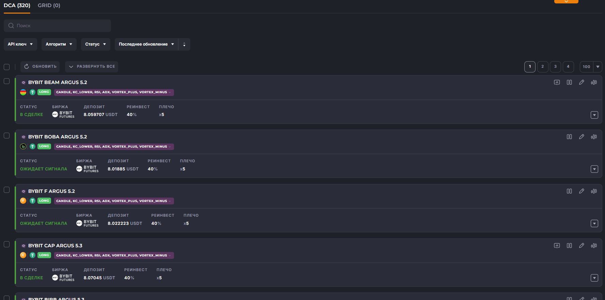
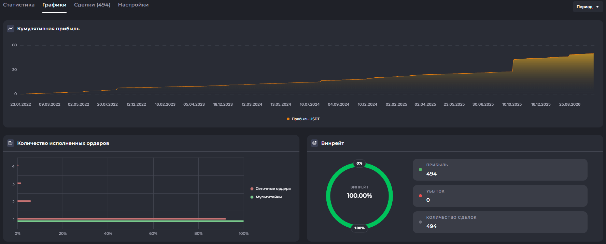

## Зачем вообще нужна автоматизация

Человечество с самого начала искало способы не делать руками то, что можно переложить на что-то другое. Колесо. Водяная мельница. Паровой двигатель. Конвейер. Каждый раз один и тот же мотив: освободить внимание и силы для того, что действительно важно.

В трейдинге этот мотив проявляется особенно остро. Рынок криптовалют не спит. Человек — спит. Или болеет. Или просто не может сидеть за экраном по шестнадцать часов.

Переход к алгоритмической торговле часто начинается именно с осознания физических и временных ограничений. Ручной мониторинг позиций 24/7 перестаёт быть реалистичным. Остаются знания, желание продолжать работать с рынком и необходимость найти способ делать это без постоянного присутствия у терминала.

Иногда этот переход начинается не с интереса к технологиям, а с ограничений. Физических, временных, финансовых. Когда физические ограничения не позволяют сидеть за терминалом, когда временные рамки не позволяют следить за позициями, когда единственный доступный ресурс — ноутбук, знания и желание выстроить систему. В таких обстоятельствах боты — не роскошь и не хобби, а единственный способ продолжать работу с рынком.

В такой ситуации естественным шагом становится формализация логики и передача исполнения системам.

Подробнее этот переход разобран в статье [«Почему алгоритмы: путь от ручного трейдинга к системной торговле»](/ru/saga/algo-journey/) — там показаны первые ошибки, механика бэктестов и архитектура системы, которая выросла из интуитивных решений.

## Маленькие помощники

Суть нормальной автоматизации трейдинга проста: пока внимание занято анализом рынка или другими задачами, торговые боты выполняют повторяющиеся действия по формализованным правилам. Это не «робот, который печатает деньги». Это набор маленьких помощников, которые закрывают рутину и позволяют заниматься тем, что невозможно делегировать.

Как это выглядит на практике:

- **DCA-бот** набирает позицию сеткой усредняющих ордеров. Если цена идёт против — бот снижает среднюю цену входа. Если цена разворачивается — закрывает всю сделку одним ордером с фиксированным процентом прибыли. Один цикл может занимать часы или дни, но внимание человека в процессе не требуется.
- **GRID-бот** работает в боковике. Внутри заданного диапазона цены бот выставляет пары ордеров: покупает на нижней границе уровня, продаёт на верхней. Чем сильнее волатильность внутри диапазона, тем больше закрытых пар. На трендовом рынке такой бот неэффективен — это ограничение, а не недостаток.
- **Боты в лонг и в шорт** могут работать параллельно на одном активе. На фьючерсах — через хеджирование позиции, на споте — через раздельные депозиты. Это позволяет системе реагировать на оба направления движения.
- **Сигнальная логика** настраивается через индикаторы технического анализа (RSI, MACD, SMA), фильтр по цене или webhook-оповещения из TradingView. На выходе — фиксированный процент прибыли, сигнал индикатора или ценовой уровень.

Каждый такой помощник покрывает конкретную рыночную ситуацию: тренд, боковик, волатильность, ночные часы, когда человек физически не может следить за терминалом. Совокупность нескольких ботов с разными настройками и направлениями формирует систему, которая работает 24/7 без присутствия оператора.

В этом и смысл метафоры: маленькие помощники трудятся постоянно. Их результат не гарантирует прибыли, но обеспечивает то, что без них невозможно — непрерывность исполнения логики, заложенной человеком.

Результат их работы — не «финансовая свобода», а покрытие операционных расходов. Подписки на инструменты, доступ к данным, инфраструктура, хостинг, плата за API. Мелочи, которые перестают висеть на основном доходе. Один бот закрыл сделку в плюс — этого хватило на подписку. Другой принес чуть больше — появился бюджет на следующий месяц. Это не стратегия богатства, а базовая гигиена самостоятельной работы.

## Платформа Veles как инструмент

Veles — это платформа, на которой логика формализуется, проверяется на истории и запускается без выделенного сервера и постоянного присутствия у терминала. Работает и со спотом, и с фьючерсами.

**Как устроен цикл работы.** Логичная последовательность выглядит так:

1. **Выбор стратегии.** В кабинете есть витрина готовых ботов от команды и сообщества. Их можно скопировать, изучить параметры и адаптировать под себя — без необходимости придумывать всё с нуля.
2. **Тестирование.** Бэктест на исторических данных показывает потенциальную доходность, максимальную просадку и количество сделок за выбранный период. Это не гарантия результата, но способ увидеть, как стратегия вела бы себя в разных рыночных режимах.

3. **Подготовка.** Перед запуском настраиваются API-ключи и блокировки — права на торговлю без права вывода. Средства остаются на бирже, платформа их не хранит.
4. **Запуск.** Бот подключается к бирже по API, выставляет и снимает ордера, сопровождает сделки. На бирже его работа видна только по ордерам и результатам их исполнения.
5. **Мониторинг.** Статистика по ботам, активные сделки, уведомления о результатах — всё это в кабинете или в мобильном приложении.

**Что поддерживается.** Подключение к крупным криптовалютным биржам через API или через Veles Broker. Три режима торговли: один ордер, сетка усреднения (DCA), простой сеточный бот (GRID). Сигналы — индикаторы TA, ценовые фильтры, вебхуки из TradingView.

**Как устроена оплата.** Сервисная комиссия — 20 % от прибыли, но не больше 50 USDT в месяц за каждый тип торговли. Оплата происходит только при наличии результата: если бот не принёс прибыль, комиссия не удерживается. Архитектура платформы построена на принципе некастодиального хранения: средства остаются на бирже, а API-ключи настраиваются с запретом на вывод.

Средства пользователя всегда остаются на бирже. Veles не выступает кастодианом и не имеет права вывода.

## Сообщество и принципы работы

Самое ценное в такой среде — не конкретные настройки ботов. Люди.

Карточку бота можно скопировать за пять минут. Но почему именно эти параметры, при каком режиме рынка они работают, что произойдёт при пробое уровня, как интерпретировать просадку и когда останавливать стратегию — всё это появляется только через обсуждение с теми, кто уже через это прошёл.

Материалов по алгоритмическому трейдингу в рунете много, но они либо академические, либо маркетинговые. Разрыв между «прочитал» и «смог запустить» закрывается средой: активный Telegram-чат, где разбирают конфигурации и ошибки, Академия для входа с нуля, документация с описанием каждой настройки, бесплатные консультации с командой.

Отдельно стоит сказать о том, как устроено взаимодействие внутри такого сообщества. Принципы, которые хорошо показывают себя в долгосрочной перспективе:

- **Не жадничать знаниями.** Разбор своей логики и ошибок — не потеря преимущества, а способ его сохранить: среда, которая растёт, растит и каждого участника.
- **Уважать друг друга и помогать.** Вопросы новичков — не шум, а входная точка для тех, кто сам когда-то задавал те же вопросы.
- **Относиться к трейдингу серьёзно.** Это не лотерея и не способ быстрой наживы. Это работа с вероятностями, рисками и дисциплиной.
- **Строить процессы достойно.** Не «выжать любой ценой», а выстроить систему, которая переживёт несколько рыночных циклов.

Именно поэтому коллективный путь оказывается устойчивее одиночного. Одиночка повторяет чужие ошибки и изобретает велосипед. В сообществе ошибки уже разобраны, а велосипед — в документации.

## Что важно понимать заранее

Автоматизация не снимает ответственности. Бот исполняет ровно ту логику, которая в него заложена. Если логика плохая — он будет аккуратно и дисциплинированно делать убытки.

Поэтому последовательность обычно такая:

1. Бэктест.
2. Небольшой депозит.
3. Наблюдение и корректировка.
4. Только потом — масштабирование.

Рынок меняется. Стратегии, которые работали полгода назад, могут перестать работать. Контроль всё равно нужен — просто он становится точечным, а не круглосуточным.

## Риски и правовые аспекты

Инвестиции в криптовалюты сопряжены с рисками частичной или полной потери капитала. Криптовалюты не являются платёжным средством на территории Российской Федерации. Результаты бэктестов и историческая доходность не гарантируют прибыль в будущем — любая торговля, ручная или автоматическая, включает риск убытков.

## Итог

Автоматизация в трейдинге — это не замена мышления, а перераспределение времени и внимания. Рутину имеет смысл отдавать системам. Анализ, архитектуру и принятие решений — оставлять за собой.

Veles — один из инструментов в такой системе. Не единственный и не волшебный. Но удобный, прозрачный по модели оплаты и достаточно гибкий, чтобы под него можно было выстраивать собственную архитектуру.

Пока боты работают, появляется пространство для того, что невозможно автоматизировать.

## FAQ

### Нужны ли знания программирования для работы с Veles?

Базовые конфигурации доступны без глубоких знаний программирования. Платформа предоставляет модульную структуру, где начальный уровень настраивается через интерфейс. По мере роста опыта появляется возможность углубляться в кастомизацию.

### Гарантирует ли Veles доход от торговли?

Любая торговля связана с риском частичной или полной потери капитала. Платформа помогает подготовиться к запуску: можно выбрать готовую стратегию, отобранную экспертами, или протестировать собственную на исторических данных с помощью бэктеста. Это помогает скорректировать настройки и снизить риски, но не исключает возможность потерь.

### Как проверить стратегию перед запуском?

Перед запуском на реальном счёте стратегию можно протестировать на исторических данных с помощью бэктеста. Он покажет, как стратегия могла бы работать в разных рыночных условиях: потенциальную доходность, максимальную просадку, количество сделок и другие показатели. Результаты тестирования не гарантируют прибыль в будущем.

### Где найти поддержку и сообщество?

Сообщество Veles активно развивается в Telegram-канале. Там публикуются разборы, обсуждения конфигураций и обмен опытом. Платформа также предоставляет Академию, базу знаний и возможность получить консультацию через Calendly.

Платформу Veles можно изучить и протестировать, зарегистрировавшись по ссылке в футтере — самом низу данной страницы. Дополнительная информация о Felag — на странице [«О проекте»](/ru/about/).